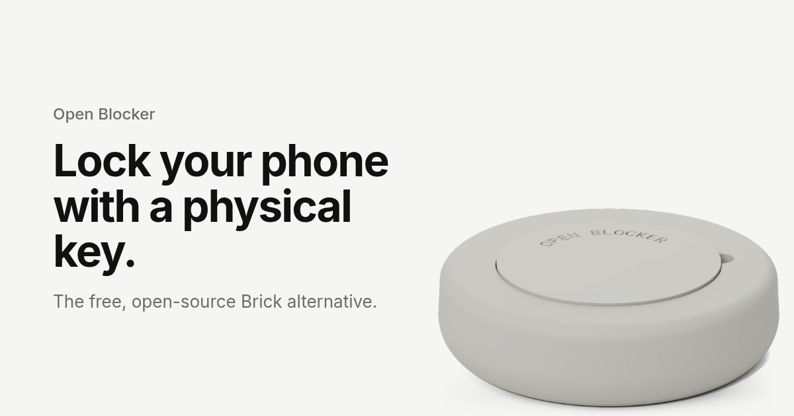
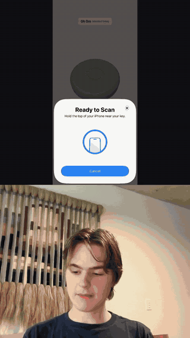
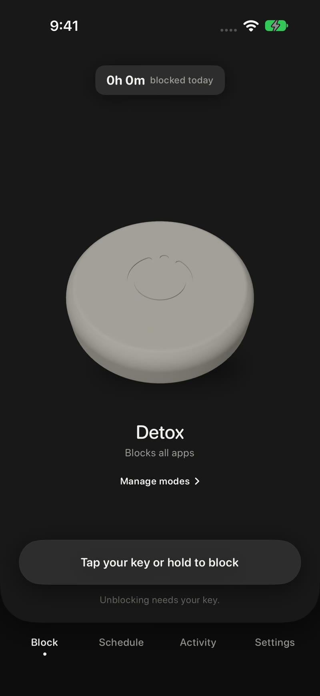
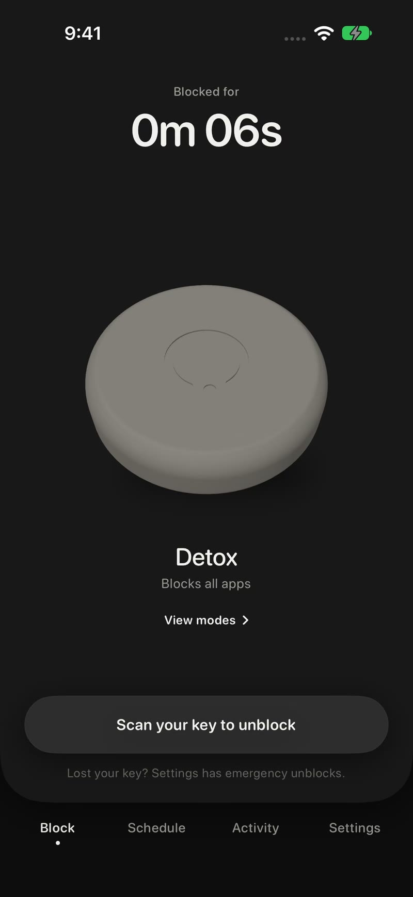
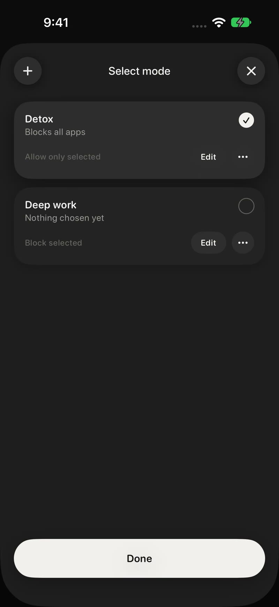
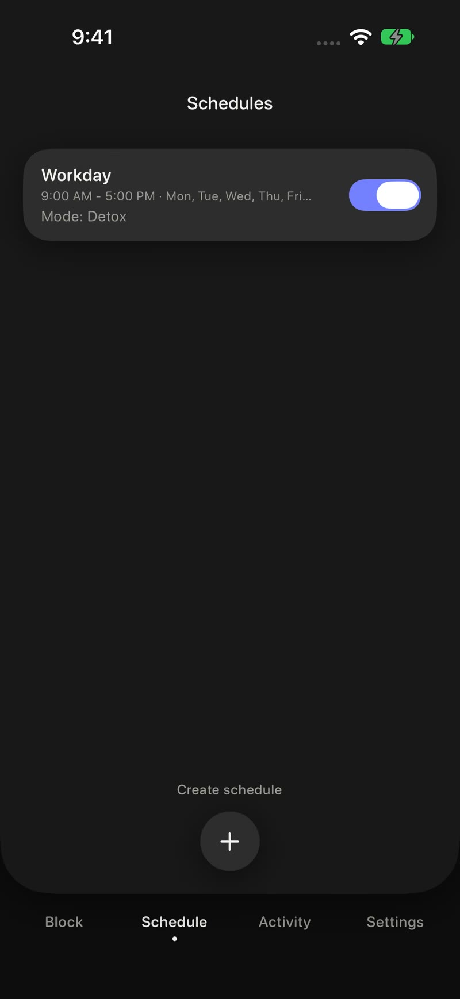
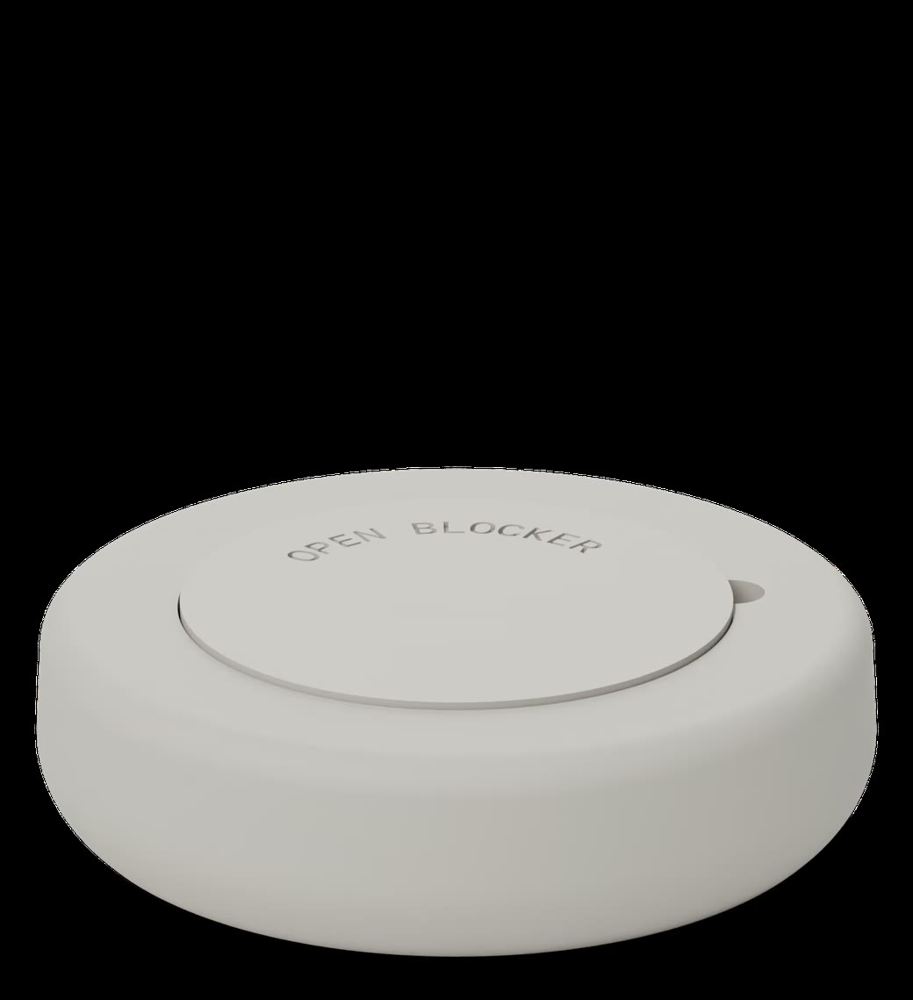
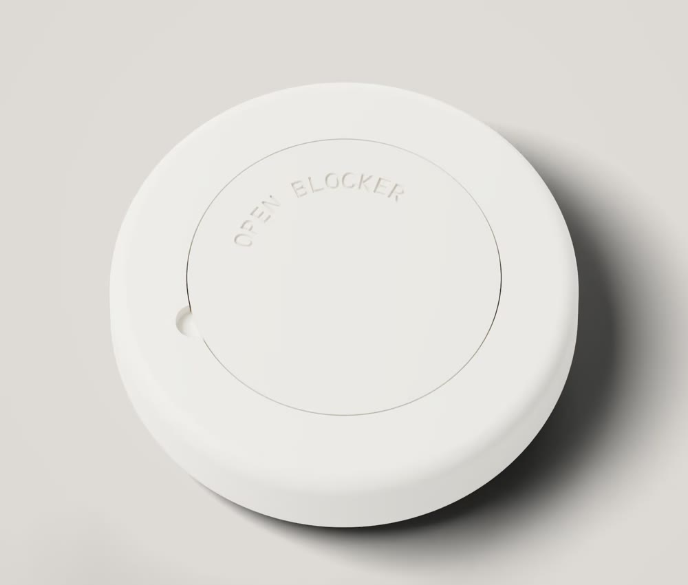

# Open Blocker

A free, open-source phone blocker you can only unlock with a physical key, like an NFC tag, a card or a printed QR code.

<p align="center">
  
</p>

<p align="center">
  <a href="https://openblocker.org"><strong>Website</strong></a>
  &nbsp;·&nbsp;
  <a href="https://apps.apple.com/app/id6824046126"><strong>App Store</strong></a>
  &nbsp;·&nbsp;
  <a href="https://github.com/fjenn/open-blocker/releases/tag/v0.2.0-alpha"><strong>Android APK</strong></a>
</p>

<p align="center">
  <a href="https://apps.apple.com/app/id6824046126"></a>
</p>

**iPhone:** 1.0.0 is on the [App Store](https://apps.apple.com/app/id6824046126) (live as of Oct 26, 2026).  
**Android:** 0.2.0-alpha APK on [GitHub Releases](https://github.com/fjenn/open-blocker/releases/tag/v0.2.0-alpha). Coming to Google Play.  
**License:** MIT · **Privacy:** [openblocker.org/privacy](https://openblocker.org/privacy) · **Terms:** [openblocker.org/terms](https://openblocker.org/terms)

## Demo

Scan your key. The apps stay locked until you walk back and scan again.

<p align="center">
  
</p>

Full iPhone walkthrough (about 80 seconds): [review-demo-take3.mp4](https://openblocker-review.vercel.app/review-demo-take3.mp4)

## Screenshots

<p align="center">
  
  
  
  
</p>

<p align="center">
  
  
</p>

Stills and key renders are from [openblocker.org](https://openblocker.org). The 25 mm case files are in [`hardware/`](hardware/).

## How it works

```
Pick the apps you want locked
        │
        ▼
 Scan your key (NFC tag, card, printed QR, or a barcode on iPhone)
        │
        ▼
 Those apps stay locked
        │
        ▼
 Walk back to the key and scan again to unlock
```

The idea is friction. You do not swipe a toggle.

- **iPhone** uses Apple's Screen Time / Family Controls APIs.
- **Android** uses Accessibility to show a block screen (and to read supported browser address bars for website rules).
- The same Open Blocker tag format works on both: NDEF `openblocker.org:tag`, or QR `openblocker://tag/v1/{32 hex}`. Spec: [`spec/SPEC.md`](spec/SPEC.md).

Not every card works. Test yours. NFC tags and QR codes can be copied. This is friction for people who want to focus, not a lock. On Android a determined person can get around the block (safe mode, uninstall, turning off Accessibility, ADB).

## Features

- Keys: NFC sticker, many NFC cards, a printed QR, and (iPhone) a barcode
- Modes: block a few apps and sites, or allow only a few
- Schedules that start a block for you
- Five emergency unblocks every six months if the key is out of reach
- No account, no ads, no subscription
- Printable 25 mm NTAG213 case in [`hardware/`](hardware/)

## Privacy

No account. No ads. No tracking SDKs. Keys, app choices and settings stay on your phone.

**Share anonymous count** is on by default in Settings. You can turn it off.

- **iPhone 1.0.0:** after each completed block, one HTTPS POST with a random install ID, `block_completed`, an event ID, the app version and `platform=ios`. No app names.
- **Android 0.2.0-alpha (GitHub Releases):** the toggle is also on by default. The released APK has no count URL, so it sends nothing.

Full policy: [PRIVACY.md](PRIVACY.md) and https://openblocker.org/privacy

## Android alpha

Download `openblocker-0.2.0-alpha.apk` from [Releases](https://github.com/fjenn/open-blocker/releases/tag/v0.2.0-alpha) and check the SHA-256. This is an early alpha, tested on an emulator. Real-phone NFC is still pending. It is not on Google Play yet (coming to Google Play).

1. Download the APK from the official release page, not from a chat app.
2. Allow the browser or Files app to install unknown apps.
3. If Play Protect blocks it, use "Install anyway".
4. Android 13+: Settings > Apps > Open Blocker > Allow restricted settings, then enable Accessibility.

Minimum Android: 7.0 (API 24). Please file what you see in [Issues](https://github.com/fjenn/open-blocker/issues).

## Build from source

```bash
cd android
./gradlew test assembleRelease
```

A signed GitHub Release APK needs `OPENBLOCKER_KEYSTORE_*` (see [RELEASE.md](RELEASE.md)). Do not commit a keystore.

iPhone (macOS, Xcode 15+):

```bash
cd ios
xcodegen generate
open OpenBlocker.xcodeproj
```

Tag format tests: `cd spec/reference && ./gradlew test`

## Credits

Builds on ideas from [Brick](https://getbrick.com), [Foqos](https://foqos.app) (MIT), [Lock](https://github.com/NathanLenias/lock-app), [nfcGuard](https://github.com/Andebugulin/nfcGuard), and [TapBlok](https://github.com/cajdata/TapBlok). iOS code adapted from Foqos, Careful, and TapBack is listed in [THIRD_PARTY_NOTICES.md](THIRD_PARTY_NOTICES.md). Android QR uses ZXing (Apache 2.0).

## License

[MIT](LICENSE). Copyright (c) 2026 Open Blocker Contributors.
